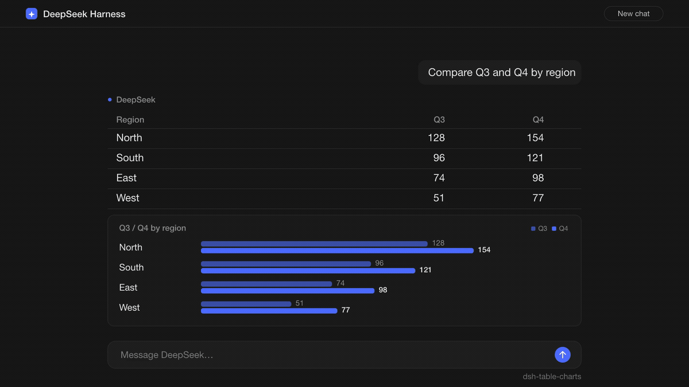
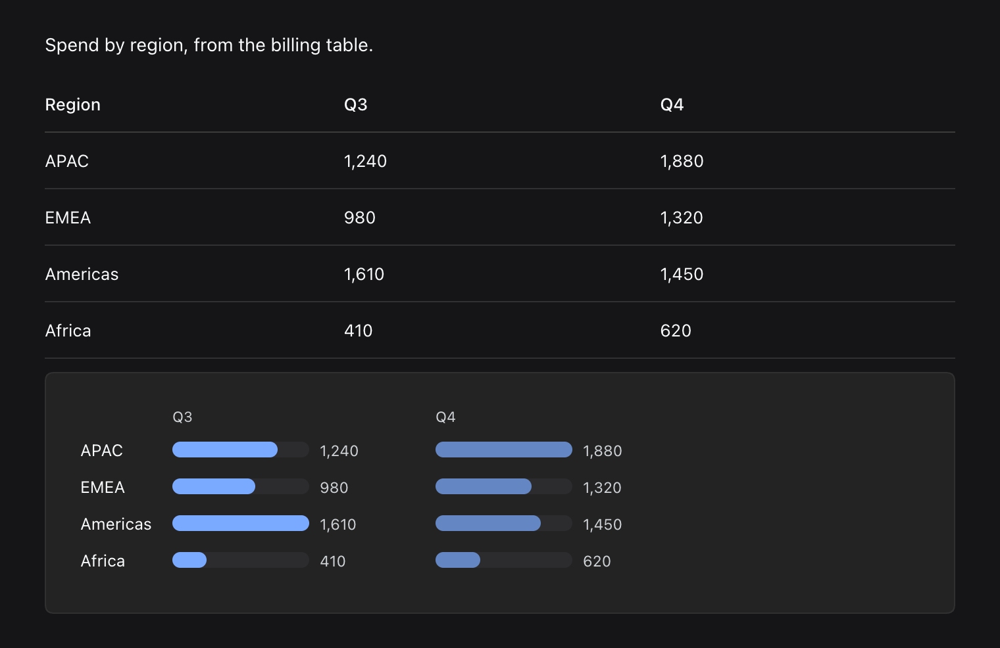
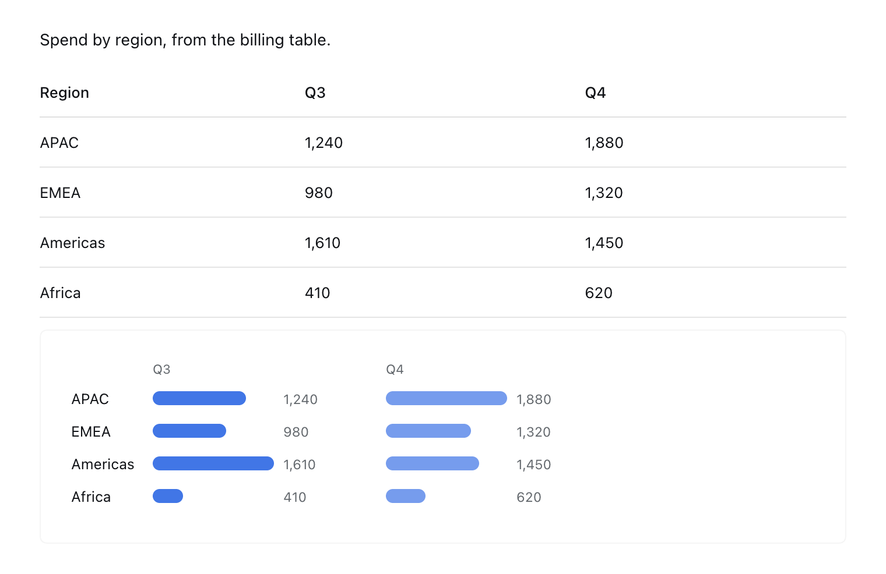

[English](https://github.com/chandra447/dsh-table-charts/blob/main/README.md) | [中文](https://github.com/chandra447/dsh-table-charts/blob/main/README.zh.md)

<p align="center">
  
</p>

<h1 align="center">dsh-table-charts</h1>

<p align="center">
  <a href="https://www.npmjs.com/package/dsh-table-charts"></a>
  <a href="LICENSE"></a>
  <a href="https://github.com/chandra447/dsh-table-charts/actions/workflows/ci.yml"></a>
</p>

<p align="center">
  
</p>

**A table of numbers makes you compare digits row by row. This plugin draws the bars for you.**

_A 25 fps motion piece rendered with fframes. [Watch the MP4](assets/hero.mp4) for 1080p._

Your assistant answered with a table. You started reading the Revenue column one cell at a time. Now there is a bar chart under it, in your theme, and nobody called a tool.

Give it a table like this:

```markdown
| Region | Revenue | Growth |
| ------ | ------- | ------ |
| North  | $1,240  | 12%    |
| South  | $980    | -4%    |
| East   | $1.6k   | 21%    |
| West   | (30)    | n/a    |
```

You get the same table, plus a card under it with two series, Revenue and Growth. `(30)` is read as -30. `n/a` shows as text where its bar would be.

## Install

In the app, open the **Plugins** window, go to **Discover**, search for `dsh-table-charts`, and install it.

From a terminal, use the profile you run:

```sh
dsh plugin --profile web add dsh-table-charts
dsh plugin --profile desktop add dsh-table-charts
```

To uninstall, swap `add` for `remove`.

The package ships a prebuilt `client.js`. Installing runs no build script, so DSH never asks you to approve one (`allowBuilds`). There is no host code and there are no dependencies. The whole thing is about 11 KB of browser JS.

Tested with DeepSeek Harness 0.2.x on macOS. The package asks for Node 22.19 or newer. The part that runs is plain browser JS. Other platforms are untested.

## What you get

- **A bar chart card under any table that looks like data.** The table itself is untouched.
- **Labels from the first column** and up to 4 numeric series side by side.
- **The original text next to each bar,** so `$1.6k` still reads `$1.6k`.
- **Theme colors.** Bars use the theme's link blue (`--dsw-alias-link`), falling back to `--dsw-alias-brand-primary`. Extra series use lighter shades of the same color. The card uses theme surface and border tokens.
- **Instant theme switches.** The SVG uses live CSS variables, so the browser repaints it with no JS involved.
- **A sensible width.** The chart stops at its natural size, so it does not stretch across a wide screen.
- **Old messages too.** Open a past session and its tables get charts.

| Dark theme | Light theme |
| --- | --- |
|  |  |

## What counts as data

A table gets a chart when it has:

- At least 2 body rows and at least 2 columns.
- At least one column, after the first, where 60% or more of the cells parse as numbers.
- No more than 24 body rows and no merged cells.

The parser reads these:

| Cell | Read as |
| --- | --- |
| `1,240` | 1240 |
| `$980` | 980 |
| `-12%` | -12 |
| `(30)` | -30 |
| `1.2k` | 1,200 |
| `3M` | 3,000,000 |
| `2B` | 2,000,000,000 |
| `n/a`, `TBD`, `12 USD` | Not a number |

`€`, `£`, and `¥` work like `$`. The `%` sign is dropped, and the value is not divided by 100.

Headers that name identifiers are never charted: `year`, `date`, `id`, `#`, `no`, `number`, `index`, `rank`, `version`. The match is on the whole header in any case, so `Year` is skipped and `Revenue per year` is not.

## When it stays out of the way

- **Text tables.** If no column is at least 60% numbers, there is no chart.
- **Tiny tables.** One body row or a single column is not a chart.
- **Long tables.** Past 24 body rows it draws nothing, rather than a chart you have to scroll.
- **Odd shapes.** Merged cells, or a table inside a table.
- **Streaming.** It waits until a table has held still for 450 ms, so it does not fight the markdown as it streams in. If the table changes later, the chart is redrawn.
- **Identifier and empty columns.** The headers listed above, and columns where every value is zero.

## Why not a tool call?

You could ask the model to call a plotting tool, or run a local chart server. This plugin does neither. The table is already on the page, so it reads the table and draws. There is no extra model turn, no tokens spent, no server to keep alive, and nothing to approve. Because it only reads the page, it works on old messages and on tables written before you installed it.

## Works with

- **Mermaid plugins and dsh-svg-fences.** Those act on code blocks. This plugin only looks at tables.

## Limits

What it does not do, on purpose:

- It does not chart every table. It guesses, and the rules above are the whole guess.
- Bar charts only. No lines, no pies, no axes, no tooltips, no settings.
- Each series is scaled to its own largest value. Bars compare rows within a column, not across columns.
- Negative numbers are drawn by size. The label keeps the minus sign, but the bar does not point the other way.
- The first column is always the labels.
- European formats like `1.240,50` and spaced thousands like `1 240` are not read as numbers.
- It does not edit the message or the table. Disable it and the charts go away.

## How it works

- One `MutationObserver` watches the page and rescans within 120 ms of a change. Each `<table>` gets a 450 ms settle timer, keyed by its text, which restarts whenever that text changes.
- Headers come from `thead`, or the first row if there is none. Rows whose cell count does not match the header are dropped. Tables with `colspan` or `rowspan` are skipped.
- Each column after the first runs through the number parser. Columns that pass the 60% rule become series, up to 4.
- The chart is an inline `<svg>` built with `createElementNS`. Cell text goes in through `textContent`, so table content cannot inject markup. Fills are `var(--dsw-alias-...)` styles, which is why theme changes cost nothing.
- The card goes after the table's wrapper `div`, so it never lands inside DSH's horizontal table scroller. A chart whose table disappears is removed on the next scan.

## Also from this pair

[dsh-svg-fences](https://github.com/chandra447/dsh-svg-fences) turns SVG code fences into rendered, theme-aware figures with a Source toggle, copy, download, and zoom. It is built the same way, as a prebuilt `client.js` with no dependencies and no server.

## Credits

The approach comes from the figure pipeline in [oh-my-pi](https://github.com/can1357/oh-my-pi). It lifts SVG fences out of assistant markdown, resolves theme tokens before rasterizing, offers a Source toggle, and turns tables into charts. This plugin is a browser-side port of those ideas for DSH, written from scratch. It contains no oh-my-pi code.

The hero animation was rendered with [fframes](https://github.com/dmtrKovalenko/fframes), a Rust and SVG video renderer. The stills show the plugin's real rendering with DSH's styles.

The DeepSeek whale in the demo comes from [LobeHub Icons](https://github.com/lobehub/lobe-icons) (MIT). DeepSeek and its logo are trademarks of DeepSeek. See [third-party notices](THIRD-PARTY.md).

## License

[MIT](LICENSE) © Chandra Doredla
