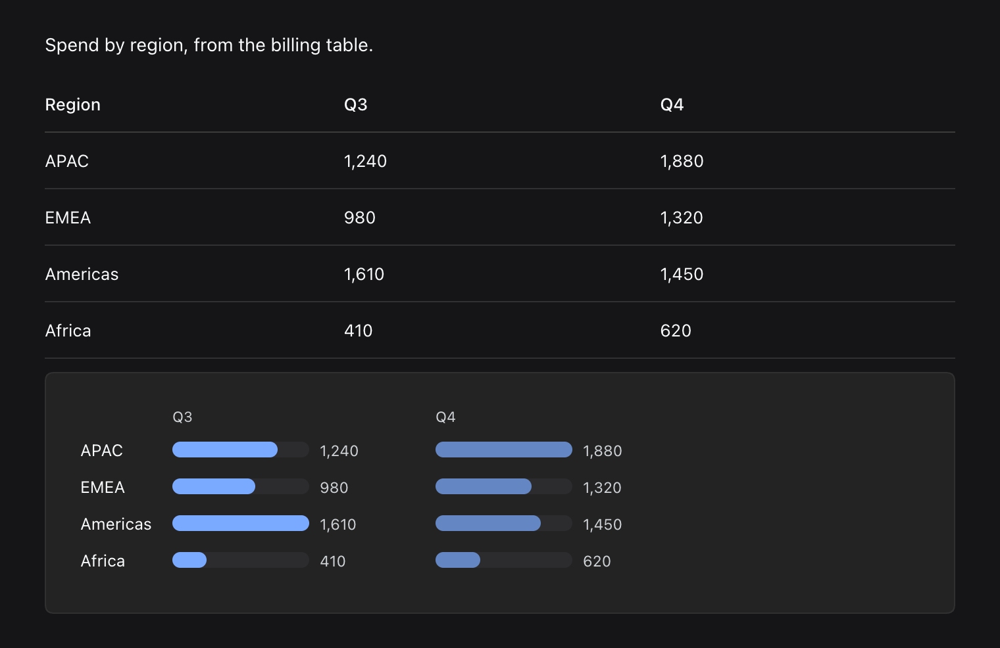
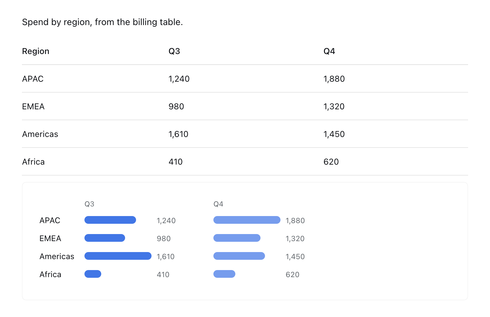

[English](README.md) | [中文](README.zh.md)

<p align="center">
  
</p>

<h1 align="center">dsh-table-charts</h1>

<p align="center">
  <a href="https://www.npmjs.com/package/dsh-table-charts"></a>
  <a href="LICENSE"></a>
  <a href="https://github.com/chandra447/dsh-table-charts/actions/workflows/ci.yml"></a>
</p>

<p align="center">
  
</p>

**满屏数字的表格，只能一行一行对着看。这个插件替你把条形图画出来。**

助手用一张表格回答了你。你开始逐格比对 Revenue 那一列。现在表格下面多了一张条形图，配色跟着主题走，而且谁也没调用工具。

给它一张这样的表格：

```markdown
| Region | Revenue | Growth |
| ------ | ------- | ------ |
| North  | $1,240  | 12%    |
| South  | $980    | -4%    |
| East   | $1.6k   | 21%    |
| West   | (30)    | n/a    |
```

表格原样保留，下面多出一张卡片，画着 Revenue 和 Growth 两组数据。`(30)` 按 -30 处理。`n/a` 不画条形，直接显示原文。

## 安装

在应用里打开 **Plugins** 窗口，进入 **Discover**，搜索 `dsh-table-charts` 并安装。

用命令行的话，按你使用的 profile 选一行：

```sh
dsh plugin --profile web add dsh-table-charts
dsh plugin --profile desktop add dsh-table-charts
```

卸载时把 `add` 换成 `remove` 即可。

包里自带构建好的 `client.js`。安装时不运行任何构建脚本，所以 DSH 不会弹出构建审批（`allowBuilds`）。没有 host 端代码，没有依赖，整个插件只有大约 11 KB 的浏览器 JS。

已在 macOS 上的 DeepSeek Harness 0.2.x 中测试。包声明需要 Node 22.19 或更高版本。真正运行的部分是普通的浏览器 JS。其他平台尚未测试。

## 你会得到什么

- **看起来像数据的表格下面，多一张条形图卡片。** 表格本身一点不动。
- **第一列做标签，** 最多并排画 4 组数值。
- **每根条形旁边都标着原文，** 所以 `$1.6k` 还是显示 `$1.6k`。
- **跟随主题配色。** 条形用主题里的链接蓝（`--dsw-alias-link`），取不到时退回 `--dsw-alias-brand-primary`。多出来的几组用同一颜色的浅色版本。卡片用主题的 surface 和 border token。
- **切换主题立即生效。** SVG 里用的是实时的 CSS 变量，浏览器自己重绘，不需要跑 JS。
- **宽度有分寸。** 图表最多显示到它的自然尺寸，宽屏上也不会被拉伸。
- **旧消息也有。** 打开以前的会话，里面的表格同样会配上图表。

| 暗色主题 | 亮色主题 |
| --- | --- |
|  |  |

## 什么算数据

表格同时满足下面几条才会画图：

- 至少 2 行数据、至少 2 列。
- 除第一列外，至少有一列 60% 以上的单元格能解析成数字。
- 数据不超过 24 行，并且没有合并单元格。

解析器认得这些写法：

| 单元格 | 解析结果 |
| --- | --- |
| `1,240` | 1240 |
| `$980` | 980 |
| `-12%` | -12 |
| `(30)` | -30 |
| `1.2k` | 1,200 |
| `3M` | 3,000,000 |
| `2B` | 2,000,000,000 |
| `n/a`、`TBD`、`12 USD` | 不是数字 |

`€`、`£`、`¥` 和 `$` 一样处理。`%` 会被去掉，数值不会再除以 100。

表头是标识符的列永远不画：`year`、`date`、`id`、`#`、`no`、`number`、`index`、`rank`、`version`。匹配的是整个表头，不分大小写。所以 `Year` 会被跳过，`Revenue per year` 不会。

## 什么时候它不出手

- **文字表格。** 没有哪一列数字占到 60%，就不画。
- **太小的表格。** 只有一行数据或只有一列，不成图。
- **太长的表格。** 超过 24 行数据就什么都不画，免得你还得滚动看图。
- **结构特殊的表格。** 有合并单元格，或者表格里套表格。
- **还在流式输出时。** 表格要稳定 450 ms 没变化才动手，不跟正在输出的 markdown 抢。之后表格有改动，图表会重画。
- **标识符列和全零列。** 上面列出的那些表头，以及所有值都是 0 的列。

## 为什么不用工具调用？

你可以让模型去调一个画图工具，或者在本地跑一个图表服务。这个插件两样都不用。表格已经在页面上了，它读了表格直接画。不多一轮模型调用，不花 token，没有要一直开着的服务，也没有要审批的东西。正因为它只读页面，旧消息里的表格、装插件之前写的表格，都能画。

## 可以一起用

- **Mermaid 插件和 dsh-svg-fences。** 它们处理的是代码块，本插件只看表格。

## 局限

下面这些是有意不做的：

- 不会给每张表格都画图。它靠猜，上面那些规则就是猜的全部依据。
- 只有条形图。没有折线、饼图、坐标轴、提示框，也没有设置项。
- 每组数据按自己列里的最大值缩放。条形比较的是同一列里的各行，不是不同列之间。
- 负数按绝对值画。标签保留负号，但条形不会反方向延伸。
- 第一列永远是标签。
- `1.240,50` 这样的欧洲写法，以及 `1 240` 这种用空格分千位的写法，都不会被当成数字。
- 不修改消息，也不修改表格。停用插件，图表就消失。

## 实现原理

- 一个 `MutationObserver` 监听页面，变化后 120 ms 内重新扫描。每个 `<table>` 有一个 450 ms 的稳定计时器，以表格文本为准，文本一变计时器就重新开始。
- 表头取自 `thead`，没有的话取第一行。单元格数量和表头对不上的行会被丢掉。带 `colspan` 或 `rowspan` 的表格直接跳过。
- 第一列之后的每一列都过一遍数字解析器。满足 60% 规则的列成为一组数据，最多 4 组。
- 图表是用 `createElementNS` 构建的内联 `<svg>`。单元格文本通过 `textContent` 写入，所以表格内容没法注入标记。填充色写成 `var(--dsw-alias-...)` 样式，这也是切换主题毫无开销的原因。
- 卡片插在表格外层的 `div` 后面，所以不会跑进 DSH 的横向表格滚动容器里。表格消失后，对应的图表会在下一次扫描时移除。

## 同系列插件

[dsh-svg-fences](https://github.com/chandra447/dsh-svg-fences/blob/main/README.zh.md) 把 SVG 代码块变成跟随主题的渲染图形，支持源码切换、复制、下载和缩放。做法相同，也是一个预构建的 `client.js`，没有依赖，不需要服务。

## 致谢

思路来自 [oh-my-pi](https://github.com/can1357/oh-my-pi) 的图形管线。它把 SVG 代码块从助手的 markdown 中提取出来，在栅格化之前解析主题 token，提供源码切换，还能把表格变成图表。本插件是把这些思路移植到 DSH 浏览器端的实现，代码从零写起，没有使用 oh-my-pi 的代码。

开头的动画用 [fframes](https://github.com/dmtrKovalenko/fframes) 渲染，这是一个基于 Rust 和 SVG 的视频渲染器。截图是插件在 DSH 样式下的真实渲染结果。

## 许可证

[MIT](LICENSE) © Chandra Doredla
